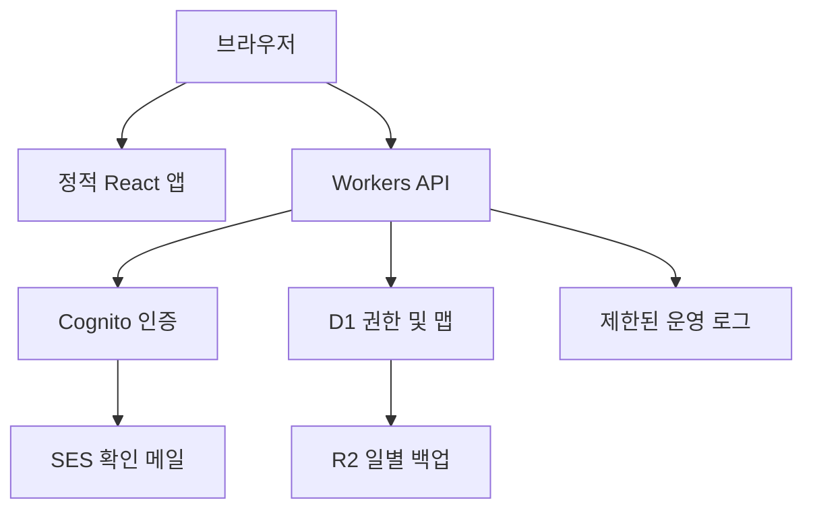

# 결정 상태 안내

D-01~03은 잠정 결정이며 최종 확정이 아니다. 아래 원문 제안은 이 문서 말미의 보완 기준으로 구체화한다.

# 아키텍처 권장안

**우선 권장: Cloudflare 정적 자산 + Workers Paid + D1, 인증은 Cognito Essentials, 이메일은 SES.** 일별 논리 백업은 R2, D1 Time Travel은 운영 복구용으로 사용한다. 비밀번호 저장·인증 서버 자체 구현은 제외한다. 이 결정은 P0 승인 제안이며 인프라를 생성하지 않았다.

|관점|A: AWS|B: Cloudflare + Cognito|
|---|---|---|
|정적 화면|비공개 S3 REST origin + CloudFront OAC|Workers static assets, 정적 경로 우선|
|인증|Cognito Essentials + SES|같은 Cognito Essentials + SES; 외부 OIDC 제공자|
|API|API Gateway HTTP API + Lambda|Workers HTTP routes|
|DB|DynamoDB on-demand; 조건부 트랜잭션|D1 SQLite; 관계형 catalog + 맵 JSON|
|동시성|TransactWriteItems 조건식|원자 batch와 SQL 조건/제약, P4 경쟁 테스트 필수|
|운영 복구|PITR + on-demand backup|Time Travel + R2 논리 export|
|강점|IAM·운영 생태계, 대규모 확장, 단일 공급자|SQL 참조/권한 구현, 낮은 묶음 요금, 정적/API 같은 origin|
|포기/주의|서비스·IAM 구성 수, JSON snapshot 쓰기 비용,400KiB item|D1 단일DB10GB·쓰기 병목, 두 공급자, 지역 보장 제약|
|초기 비용|10~100MAU는 더 저렴할 수 있음|Workers Paid 최소$5; 무조건 최저가 아님|

B 선택의 이유는 비용만이 아니다. 3~4인 팀의 초대/역할/프로젝트 관계를 SQL로 다루고 하나의 서버리스 API에서 권한을 집중시키기 쉽다. AWS 운영 역량이 이미 충분하거나 데이터 위치·조달·IAM 통합이 중요하면 A로 바꿀 근거가 충분하다. P4 측정에서 D1의 CAS/쿼리·한국 접속 지연 요구를 충족하지 못하면 A를 재검토한다.

백업 화살표는 예약된 export 작업이 D1을 읽어 R2에 저장한다는 뜻이며 DB가 자동으로 R2에 복제된다는 뜻이 아니다. 예약 export는 실제 구현·복원 검증이 필요하다.

## 프론트/백엔드 경계

프론트: graph rendering·선택·Inspector·로컬 draft·JSON/Markdown 미리보기. 백엔드: 인증 세션·소유권·membership·schema/참조 검증·저장 revision·usage·초대·공유 projection·billing entitlement. private 맵을 정적 번들에 포함하지 않는다. `VITE_*` 변수는 공개 값만 허용한다.

React Router를 사용할 경우 static host의 SPA fallback은 화면 경로에만 적용하고 `/api/*`·정적 파일404를 index.html200으로 바꾸지 않는다. S3로 전환할 때는 CloudFront의 private S3 origin과 OAC, HTTPS, 캐시 정책을 설정한다. S3 website endpoint는 OAC 방식과 다르다. 인증 API는 CDN에서 no-store; 해시된 assets만 immutable.

S3+CloudFront로 프론트를 배포해도 동일 backend와 연결 가능하다. 권장 운영은 같은 origin `/api` 프록시이며 별도 API origin을 쓰면 정확한 CORS allowlist·credentials·cookie domain/CSRF 정책이 추가된다. “정적 배포 가능”은 backend가 불필요하다는 뜻이 아니다.

## 인증 흐름 제안

Cognito **Essentials Managed Login**을 사용하고 `lang=ko`로 한국어 가입/로그인/암호 재설정을 설계한다. 공식 문서에서 한국어 지원과 Essentials/Plus 요구를 확인했다. [Managed Login 공식 문서](https://docs.aws.amazon.com/cognito/latest/developerguide/cognito-user-pools-managed-login.html). 자체 비밀번호 폼을 만들지 않아 유지보수 범위를 줄인다. P4에서 실제 이메일 문구·오류·리다이렉트·재설정 전체를 한국어로 검증한다. 저가 대안 Lite는 별도 한국어 인증 폼 구현비와 위험을 추가로 평가해야 하므로 기본안에서 제외한다.

OIDC authorization code+PKCE, state/nonce 검증. Worker callback에서 토큰 검증 후 opaque session을 HttpOnly/Secure/SameSite=Lax cookie로 발급한다. 서버 Session에는 토큰 hash와 만료/사용자 매핑, 필요한 refresh token은 암호화하여 보관한다. 로그아웃은 서버 session 폐기와 provider logout을 함께 수행한다. JWT 검증과 앱 membership 검사는 별개다.

## API 계약 초안

|작업|경로 예시|서버 조건|
|---|---|---|
|프로젝트 목록|GET /api/workspaces/:wid/projects|session+membership, 접근 가능한 project만|
|맵 읽기|GET /api/projects/:pid/maps/:mid|wid를 서버에서 조회·대조, 프로젝트 역할|
|맵 저장|PUT /api/maps/:mid|editor 이상, baseRevision, mutationId, schema/bytes/quota|
|맵 복원|POST /api/maps/:mid/restore|현재 revision 일치, 지정 snapshot 읽기 권한|
|초대|POST /api/projects/:pid/invitations|project owner 또는 workspace admin, 좌석 limit|
|공유 생성/해지|POST/DELETE /api/maps/:mid/shares|owner/admin만, published projection 재검증|
|공유 읽기|GET /api/share/:token|hash lookup, expiry/revocation, 공개 snapshot만|
|import|POST /api/imports + commit|검증·staging·원자 노출, idempotency|
|사용량|GET /api/workspaces/:wid/usage|멤버 허용 범위, 서버 집계|

401 인증 필요,403 권한 거부,404 존재 숨김이 필요한 cross-tenant 조회,409 revision/멤버십 변경 충돌,413 크기,422 검증,429 제한,503 일시 장애. 응답은 `{code,message,requestId,details?}`이며 내부 SQL/토큰은 노출하지 않는다.

## 배포·운영 전제

dev/staging/prod DB·auth client·secret을 분리한다. 본 P0는 원격 환경을 만들지 않았다. 배포 산출물과 DB migration rollback, rate limits, 예산 알람, 백업 복원 절차를 P8/P9 승인 게이트로 둔다. Workers 로그 가격은 **2026-12-01 변경 예정**이므로 출시 시 재산정한다.

공식 근거(2026-10-09): [D1 API](https://developers.cloudflare.com/d1/worker-api/d1-database/), [D1 제한](https://developers.cloudflare.com/d1/platform/limits/), [Cognito PKCE](https://docs.aws.amazon.com/cognito/latest/developerguide/using-pkce-in-authorization-code.html), [Cognito 요금/기능](https://aws.amazon.com/cognito/pricing/), [CloudFront OAC](https://docs.aws.amazon.com/AmazonCloudFront/latest/DeveloperGuide/private-content-restricting-access-to-s3.html). 설계의 채택 판단은 이 자료와 코드 분석에 근거한 제안이다.

## 2026-10-10 결정 보완 기준

D-01/D-02/D-03은 **잠정 결정(프로토타입·Spike 검증 전)**이다. P0의 최종 상태는 **보완 완료 / 외부 검수 대기**이며 최종 PASS가 아니다. 사용자의 이번 요청 “P0 프롬프트 확인해서 작업 진행 / P1 프롬프트 진행 / 진행상황을 나눠서 진행”은 P0 보완 후 **P1 정적 디자인 작업 착수에 대한 직접 지시**로 기록한다. 이는 P0 기술 확정이나 외부 검수 PASS를 대신하지 않는다. P0 보완 패키지를 먼저 동결한 뒤 P1을 별도 단계로 수행하며 P2는 금지한다.

D-01이 기존 권장안의 상태를 규정한다. BFF cookie는 확정 구현이 아니며 Spike에서 same-origin `/api` 경로와 별도 origin 대안을 비교한다. 별도 origin일 때 정확한 CORS allowlist·credentials·SameSite·CSRF 검증이 필요하다. JWT 유효함만으로 membership 또는 계정 차단 해제를 인정하지 않는다.
