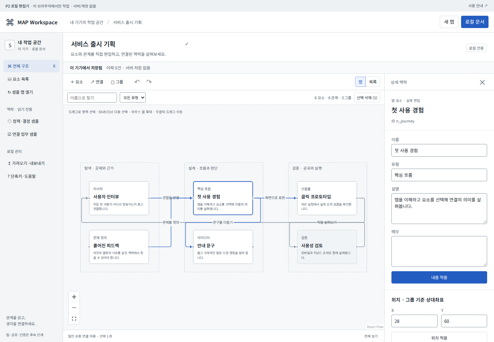
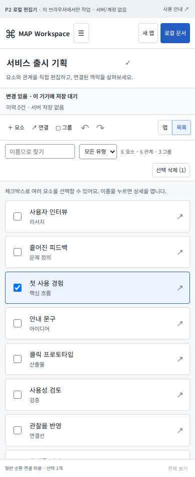

# P2 완료 — 외부 검수 대기

2026-10-10 · MAP Workspace v0.2.0. P0/P1 승인에 이어 P2.0~P2.5 구현을 완료했습니다. P3는 시작하지 않았습니다.

|단계|결과|
|---|---|
|P2.0|P0/P1·참고 소스 대조, 라이선스 확인, 독립 프로젝트·P2 로컬 계약|
|P2.1|실제 노드/연결 CRUD, 선택·다중 선택·이동·확대, Inspector|
|P2.2|그룹·좌표 변환·해제/삭제, 일반 순환·1-hop 탐색·검색|
|P2.3|명령 Undo/Redo, 드래그 단일 이력, 키보드·합성 IME 보호|
|P2.4|로컬 자동저장·새로고침 왕복·P2 JSON·손상/용량 복구|
|P2.5|단위22·통합33·접근성15 PASS, 성능 실측·4화면폭·정적 패키징|

500노드/1000연결에서 선택 p95 **84.3ms**(목표100ms). 실행한 검증 범위에서 Critical/Major 미해결0건입니다. 실제 한글 IME·브라우저200%·스크린리더·터치·다른 브라우저·깨끗한 npm 설치 완료는 **UNVERIFIED**이며 외부 검수에서 확인해야 합니다.

## 주요 결과 화면

그룹/연결 Inspector와 실제 편집 결과는 `screenshots/p2-group-inspector.png`, `p2-edge-inspector.png`, `p2-edited-group.png`에 있습니다. 원본 화면은 자동 브라우저에서 실제 앱을 조작한 결과이며 디자인 목업이 아닙니다.

## 외부 검수 순서

1. 실행용 ZIP의 `START.cmd` 또는 `node scripts/serve-dist.mjs`로 열고 노드를 만들고 내용을 적용합니다.
2. 노드 다중 선택→그룹화→그룹 이동→해제, 순환 연결, 삭제 후 Undo를 확인합니다.
3. JSON 내보내기 후 새로고침/가져오기로 같은 지도와 표시 상태를 확인합니다.
4. 390px 목록과 상세 편집, 한글 IME, 실제200% 확대·스크린리더·터치를 확인합니다.
5. 소스 ZIP의 README에 따라 새 설치·빌드·검사를 실행하고 미검증 항목을 기록합니다.

저장은 이 브라우저 전용입니다. 서버·계정·공유·결제는 없으며 결정/업무는 읽기 전용 샘플입니다. P2 JSON은 제품용 최종 백업 계약이 아닙니다. 입력한 폼 값은 해당 적용 버튼을 누른 뒤 저장됩니다.

전체 근거: [QA](QA_REPORT.md), [성능](PERFORMANCE.md), [저장 경계](STORAGE_BOUNDARY.md), [편집 계약](EDITOR_CONTRACT.md), [P3 인계](../../HANDOFF.md). 승인 후에만 P3를 진행합니다.
